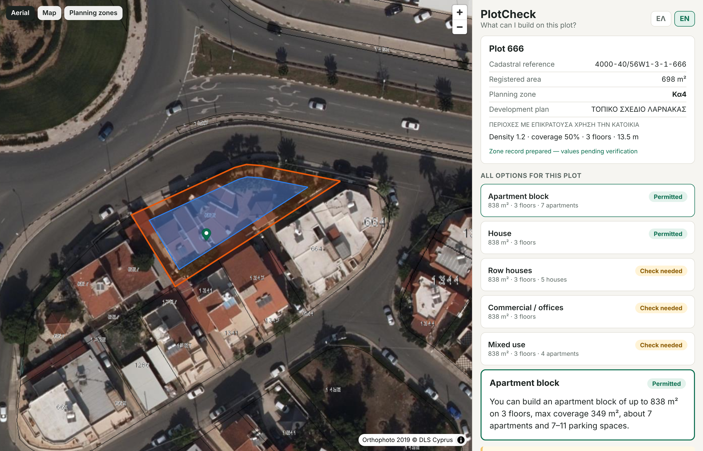

# PlotCheck (working name) — phase 1 prototype

Tap a plot on the map, then see its official cadastral record, its planning zone and how much can
be built on it. Web only in phase 1, built on the multi-country architecture from
[`docs/TECHNICAL_PLAN.md`](docs/TECHNICAL_PLAN.md). Cyprus is the first country module.



## What works

- **Map → plot.** Tap anywhere, and the plot comes from the Department of Lands and Surveys (DLS)
  cadastre. Neighbouring plots are offered if you tapped near a boundary. "Find the plot I'm
  standing on" uses GPS.
- **Plot → zone.** The planning zone, development plan and published coefficients (density,
  coverage, floors, height) come from the DLS planning-zone layer. The parcel is sampled at
  several points, so plots that straddle zones are detected.
- **Zone → rules.** OZFS-based rule layers are merged along country → district → municipality
  → plan → zone. One curated zone (Κα4, Larnaca Local Plan) is included. Other zones fall back
  to DLS coefficients and country defaults and are clearly flagged.
- **Calculation.** A pure TypeScript engine, adapted from zoneR, works out:
  - buildable area, coverage and floors;
  - the per-floor split;
  - the footprint after boundary setbacks, on the real plot shape;
  - height, unit mix and parking.

  Every check returns allowed / not allowed / maybe with a reason. "Show me all options"
  compares all five building types.
- **Relaxations (χαλαρώσεις) across Cyprus.** Every result also shows the plot with all
  available relaxations and incentives applied: Order 4/2026, the RES bonus, the affordable-
  housing scheme, and Larnaca Local Plan incentives. Each is cited with its rule, conditions and
  cost. See [`docs/RELAXATIONS.md`](docs/RELAXATIONS.md).
- **Financial feasibility (Larnaca).** For the chosen building type, with or without the
  relaxations, the app estimates sales value, construction and soft costs, the maximum land
  price that still leaves the developer's target profit (residual land value, after DLS transfer
  fees), profit and margin at an asking price, and rental yield. Sale price, construction cost,
  finish level, basements and profit target are editable and recompute on the device. The DLS
  General Valuation (1/1/2021) value for the plot's area and zone is shown for comparison. All
  figures are estimates, ex-VAT, with sources listed.
- **Comparable sales and option comparison.** Import a comparable-sales file (e.g. the DLS
  "Comparable Sales" export or a valuer's list, CSV/Excel, Greek or English columns) or add sales by
  hand: the app keeps the last 6 (or 12) months, removes outliers and uses the average price per m²
  of each kind (apartments, houses, commercial) as the sale price. The district market (DLS open
  data: number of sales and average value per sale, last 6 months) is shown as context. Every
  allowed building type is compared side by side: what gets built, sales value, construction cost,
  total development cost and the land price it can carry.
- **PDF report.** One click builds an A4 report on the device (Greek or English): the plot,
  an orthophoto map with the plot and the buildable footprint, the planning zone, restrictions,
  what can be built, the relaxations, the finance with the user's own assumptions, the engineer's
  checklist, unverified values and the disclaimer. Example: `docs/sample-report-666-el.pdf`.
- **Trust.** Every unverified value is listed under a warning, together with its source. Every
  result shows the "to be checked by an engineer" list and the disclaimer.
- **Greek and English** throughout, with local number formats.

## Layout

```
packages/core           types, OZFS-EU rules schema, safe expression evaluator, rule hierarchy
packages/engine         calculation engine (pure, no I/O, no country code)
packages/country-sdk    CountryModule interface, registry, provider fallback
packages/countries/cy   Cyprus: DLS REST + WFS parcel providers, planning zones, rules, el/en strings
packages/api            HTTP handlers (Request → Response), cache, rate limiting
apps/api-dev            Node dev server for the API
apps/app                Expo Router app (web now; iOS/Android in phase 3)
supabase/functions/api  the same API as a Supabase Edge Function (Deno)
supabase/migrations     Postgres + PostGIS schema with RLS
```

A lint rule stops `core`, `engine`, `country-sdk` and `api` from importing any country module.

## Run it

```bash
npm install
```

```bash
npm run dev:api        # API on http://localhost:8787
```

```bash
npm run dev:web        # app on http://localhost:8081 (EXPO_PUBLIC_API_URL defaults to :8787)
```

Deep link: `http://localhost:8081/?lng=33.615&lat=34.93&z=19` opens the curated Κα4 test plot.

Checks:

```bash
npm test && npm run typecheck && npm run lint
```

## Deploy (Supabase, EU region)

```bash
supabase db push
```

```bash
supabase functions deploy api --no-verify-jwt
```

Set `ALLOWED_ORIGINS` as a function secret. Set `DLS_API_TOKEN` once the DLS credentials are
issued (phase 2). Point the app at the function with
`EXPO_PUBLIC_API_URL=https://<project>.supabase.co/functions/v1/api`.

## Known limits (phase 1)

- Only Κα4 (Larnaca LP) has a curated record, and nothing is verified by an architect yet.
- Permitted uses come from the zone-code letter (a heuristic, flagged for review).
- A single uniform boundary setback is used. Front setbacks and street alignment are flagged
  for an engineer to check.
- Not built yet: document scan, accounts, paywall. The PDF download works on the web; on
  iOS/Android it arrives with the store builds (share sheet). Finance defaults are listing-based
  estimates for Larnaca; they are not a valuation.
- OSM street tiles are for the prototype only. "PlotCheck" is a placeholder brand.
- Greek copy needs review by a native speaker.

See [`NOTICE.md`](NOTICE.md) for credits (zoneR, OZFS, DLS data).
